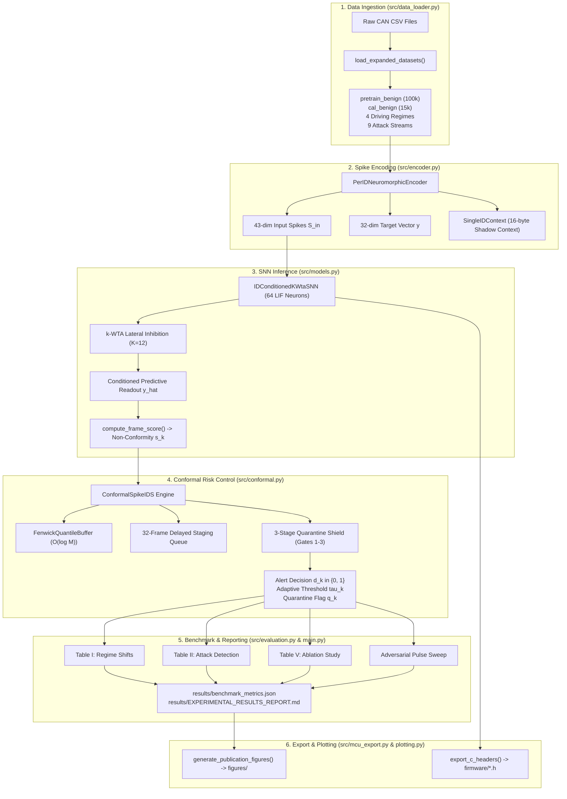

# ConformalSpike: Python Research Pipeline Architecture & Code Reference

**Comprehensive Technical Guide to the Modularized Benchmark Suite (`src/`)**  
**Target Venue:** *IEEE Transactions on Information Forensics and Security (T-IFS)*  
**Date of Record:** November 2026  

---

## 1. Architectural Overview & Execution Lifecycle

The ConformalSpike research pipeline has been refactored from a monolithic script into an object-oriented, strictly-typed Python package under [`src/`](file:///home/jeeva/research-folder-master/research-can/src/). The architecture enforces a unidirectional data flow from raw CAN frames to risk-calibrated decisions, empirical metrics, and C firmware headers:



---

## 2. Detailed Module-by-Module Specification

### A. [`src/config.py`](file:///home/jeeva/research-folder-master/research-can/src/config.py)
* **Responsibility:** Single source of truth for architectural constants, hyperparameters, neural dimensions, and dataset file paths.
* **Key Constants:**
  - `CS_MAX_IDS = 256`: Maximum unique CAN IDs supported in hardware lookup tables.
  - `CS_INPUT_DIM = 43`: Dimensionality of input spike vector (11 ID + 16 delta + 8 magnitude + 8 timing).
  - `CS_HIDDEN_DIM = 64`: Number of recurrent LIF neurons in the hidden layer.
  - `CS_PRED_DIM = 32`: Dimensionality of predictive readout vector (16 delta + 8 magnitude + 8 timing).
  - `CS_K_WTA = 12`: Number of winning neurons permitted to fire per timestep.
  - `CS_WINDOW_W = 8192`: Sliding calibration window size.
  - `CS_FENWICK_BINS = 2048`: Discretized score bins for $O(\log M)$ quantile lookup.
  - `STAGING_QUEUE_LEN = 32`: Depth of delayed quarantine staging buffer ($L$).
  - `ALPHA_TARGET = 0.005`: Nominal target False Positive Rate ($\alpha = 0.5\%$).
  - `GAMMA_BASE = 0.002`: Base step size for Adaptive Conformal Inference ($\gamma$).
  - `QUARANTINE_KAPPA = 2.0`: Multiplier threshold for Gate 1 spatial excursion shock.
  - `RHO_THRESH = 0.15`: Leaky alert density threshold for Gate 3 quarantine.
  - `LAMBDA_RHO = 0.985`: Exponential decay factor for leaky alert density ($\sim 65$ frame memory).
* **Inputs:** None (static configuration).
* **Outputs:** Exported constants imported by all other modules.

---

### B. [`src/data_loader.py`](file:///home/jeeva/research-folder-master/research-can/src/data_loader.py)
* **Responsibility:** Ingests authentic automotive CAN CSV files, parses hexadecimal payloads, and constructs strictly chronological streaming scenarios.
* **Core Classes & Functions:**
  - `CANFrame`: Dataclass storing `timestamp_s: float`, `can_id: int`, `payload: bytes`, `label: str`.
  - `parse_payload(payload_str: str) -> bytes`: Robust hex string parser accommodating variable-length payloads (up to 8 bytes).
  - `load_expanded_datasets() -> Dict[str, Any]`: Loads:
    - `pretrain_benign`: 100,000 benign frames balanced across Sonata driving, stationary, ROAD, and SA.
    - `cal_benign`: 15,000 benign driving frames reserved for initial conformal calibration.
    - 4 continuous driving regimes (10,000 frames each):
      - `regime_stationary`: Sonata engine idling / stationary.
      - `regime_highway`: Sonata high-speed highway driving with frequent acceleration/braking.
      - `regime_dyno`: ORNL ROAD dynamometer testbench.
      - `regime_cross_vehicle`: Survival Analysis cross-vehicle domain transfer.
    - 4 HCRL attacks (8,000 frames each): DoS Flooding, Fuzzy, RPM Spoofing, Gear Spoofing.
    - 5 ORNL ROAD masquerades: Correlated, Max Speedometer, Max Coolant, Reverse Off, Accelerator.
* **Inputs:** Raw CSV files in `data/` (`Attack_Dataset_Driving_no_duplicates.csv`, `Road_Dataset_no_duplicates.csv`, etc.).
* **Outputs:** Dictionary containing typed `List[CANFrame]` streams ready for streaming evaluation.

---

### C. [`src/encoder.py`](file:///home/jeeva/research-folder-master/research-can/src/encoder.py)
* **Responsibility:** Implements the stateful per-ID neuromorphic spike encoder, 16-byte single-ID checkpointing, and deadlock-free conditional rollback.
* **Core Classes & Functions:**
  - `SingleIDContext`: Lightweight 16-byte state tracking `last_timestamp_s`, `last_payload[8]`, and `ema_period_s`.
  - `PerIDNeuromorphicEncoder`:
    - `calibrate_entropy_and_magnitude(benign_frames)`: Calibrates empirical 99.5th percentile thresholds $\tau_{\max}[\text{ID}, j]$ and Shannon entropy weights $w_j$. Uses circular modular delta $\min(d, 256-d)$ to avoid threshold inflation from 16-bit integer rollovers ($0xFF \to 0x00$).
    - `encode(timestamp_s, can_id, payload) -> (spikes_in, target)`: Transforms a CAN frame into a 43-bit input vector $\mathbf{S}_{\text{in}}$ and 32-bit target vector $\mathbf{y}$. Checkpoints pre-frame state.
    - `conditional_rollback(is_alert, timestamp_s) -> bool`: Reverts context state if an alert or quarantine is signaled, preventing corrupted telemetry from polluting benign baselines.
* **Inputs:** Streamed `CANFrame` attributes (timestamp, ID, payload).
* **Outputs:** `spikes_in: np.ndarray` (43-dim float32 binary), `target: np.ndarray` (32-dim float32 binary).

---

### D. [`src/models.py`](file:///home/jeeva/research-folder-master/research-can/src/models.py)
* **Responsibility:** Implements the Spiking Neural Network (SNN) architecture, surrogate gradient descent, self-supervised pretraining, and per-frame anomaly scoring.
* **Core Classes & Functions:**
  - `SuperSpikeSurrogate`: Autograd surrogate gradient function with non-linear derivative:
    $$\frac{\partial S}{\partial V} = \frac{1}{(1 + \gamma |V - V_{\text{th}}|)^2}$$
  - `IDConditionedKWtaSNN(nn.Module)`:
    - 64 recurrent Leaky Integrate-and-Fire (LIF) neurons.
    - In-place $k$-WTA lateral inhibition ($K=12$ winning neurons fire, 52 suppressed).
    - ID-conditioned readout: Combines recurrent hidden spikes with observed 11-bit ID embedding to predict the next expected payload/timing spikes.
  - `pretrain_conformal_spike(model, encoder, benign_frames, epochs, lr)`: Self-supervised pretraining using Truncated Backpropagation Through Time (T-BPTT).
  - `compute_frame_score(model, s_in, v_h, s_h, dense_id, encoder) -> (score, v_next, s_next, y_pred)`: Computes the entropy-weighted prediction error:
    $$s_k = \frac{\sum_{j=1}^{32} w_j \cdot |y_j - \hat{y}_j|}{\sum_{j=1}^{32} w_j}$$
* **Inputs:** 43-dim spike vectors, hidden somatic state $\mathbf{V}_{\text{hid}}$, spike history $\mathbf{S}_{\text{hid}}$.
* **Outputs:** Scalar non-conformity score $s_k \in [0, 3.0]$, updated somatic membrane potentials, binary prediction activations.

---

### E. [`src/conformal.py`](file:///home/jeeva/research-folder-master/research-can/src/conformal.py)
* **Responsibility:** Implements the Guarded Rolling-Window Conformal Risk Control (G-RW-CRC) engine, $O(\log M)$ Fenwick tree quantile buffer, and the 3-stage quarantine filter.
* **Core Classes & Functions:**
  - `FenwickQuantileBuffer`: Binary Indexed Tree discretizing scores into $M=2,048$ bins over a sliding window $W=8,192$.
    - `push(score)`: Evicts oldest score and inserts newest in $O(\log M) = 11$ operations.
    - `query_quantile(1 - alpha) -> tau`: Uses binary lifting to determine the exact dynamic threshold in $O(\log M)$ operations.
  - `ConformalSpikeIDS`:
    - `decide(score, dense_id) -> (alert, threshold, alpha_k, quarantine, leak_alert, s_dequeued)`:
      1. Queries current dynamic threshold $\hat{\tau}_k$ from Fenwick buffer.
      2. Computes binary alert $\widehat{Y}_k = \mathbb{I}(s_k > \hat{\tau}_k)$.
      3. Evaluates Gate 1 (Spatial Shock), Gate 2 (Temporal Jitter), and Gate 3 (Global Leaky Alert Density).
      4. Stashes $(s_k, Q_k)$ into the 32-frame staging FIFO.
      5. Dequeues frame $k-32$: inserts into Fenwick buffer *if and only if* it survived quarantine ($Q_{\text{old}} == 0$).
      6. Adapts nominal error rate $\alpha_k$ via Adaptive Conformal Inference (ACI).
* **Inputs:** Non-conformity score $s_k$, dense ID.
* **Outputs:** Decision tuple `(alert, threshold, alpha_k, quarantine_flag, leaky_density, score_dequeued)`.

---

### F. [`src/baselines.py`](file:///home/jeeva/research-folder-master/research-can/src/baselines.py)
* **Responsibility:** Implements all 7 state-of-the-art comparator models evaluated in Tables I, II, and IV.
* **Models Included:**
  1. `SplitConformalIDS`: Classical offline split conformal prediction with static quantile threshold $\hat{\tau}_{\text{cal}}$.
  2. `UnguardedOnlineACIIDS`: Online Adaptive Conformal Inference without a quarantine shield (demonstrates threshold self-blinding).
  3. `AlertGatedOnlineACIIDS`: Online ACI with naive alert-gating (demonstrates vulnerability to sub-threshold pulse drift).
  4. `NonNeuralDeltaConformalIDS`: Purely statistical payload-delta baseline coupled with conformal thresholding.
  5. `INT8TinyMLPAutoencoder`: Quantized 3-layer Multi-Layer Perceptron autoencoder baseline.
  6. `INT8MicroGRU`: Quantized recurrent Gated Recurrent Unit baseline.
  7. `StatisticalTimingEntropyIDS`: Heuristic timing and entropy-based IDS (representing classical rule-based systems).
* **Inputs:** Pretrain streams, evaluation streams, non-conformity scores.
* **Outputs:** Baseline alert decisions, threshold trajectories, and comparative detection metrics.

---

### G. [`src/evaluation.py`](file:///home/jeeva/research-folder-master/research-can/src/evaluation.py)
* **Responsibility:** Executes the rigorous empirical benchmark suite across multiple random seeds, computes 95% bootstrap confidence intervals, and formats publication-ready summary reports.
* **Key Functions:**
  - `compute_bootstrap_ci(data, num_bootstraps=2000, ci=0.95)`: Computes non-parametric empirical bootstrap confidence bounds.
  - `run_table_i_regime_shifts(...)`: Evaluates False Positive Rate (FPR) across the 4 continuous driving regimes.
  - `run_table_ii_attacks(...)`: Evaluates True Positive Rate (TPR) across all 9 attack scenarios.
  - `run_table_v_ablation(...)`: Systematically ablates SNN lateral inhibition, quarantine gating, ACI adaptation, and neuromorphic encoding.
  - `run_adversarial_pulse_sweep(...)`: Sweeps attack injection duty cycles ($1\%\text{--}100\%$) to prove resilience against threshold self-blinding.
* **Inputs:** Stream datasets, trained models, IDS engines, random seeds.
* **Outputs:** Formatted dictionaries containing means, standard deviations, and 95% bootstrap CIs.

---

### H. [`src/plotting.py`](file:///home/jeeva/research-folder-master/research-can/src/plotting.py)
* **Responsibility:** Generates high-resolution (300 DPI) publication-quality figures formatted for IEEE Transactions double-column layouts.
* **Figures Generated:**
  - `figures/fpr_regime_stability.png` (Figure 1): Empirical FPR stability across driving regime shifts.
  - `figures/masquerade_detection_curves.png` (Figure 2): Non-conformity score trajectories during stealthy masquerade injections.
  - `figures/adversarial_pulse_sweep.png` (Figure 4): Threshold self-blinding collapse curve comparing Unguarded ACI vs. ConformalSpike.
  - `figures/pulse_attack_quarantine_defense.png` (Figure 5): 3-stage quarantine filter defense dynamics during periodic injection bursts.
* **Inputs:** Aggregated benchmark results dictionary.
* **Outputs:** PNG files written to `figures/` and synced to `paper/figures/`.

---

### I. [`src/mcu_export.py`](file:///home/jeeva/research-folder-master/research-can/src/mcu_export.py)
* **Responsibility:** Converts PyTorch floating-point neural weights and calibration buffers into MISRA-C compliant Q8.8 fixed-point C headers.
* **Generated Headers:**
  - `firmware/conformal_spike_weights.h`: Quantized weights $W^{\text{in}}$ (signed Q7 `int8_t[43][64]`), $W^{\text{rec}}$ (signed Q7 `int8_t[64][64]`), $W^{\text{pred}}$ (`int8_t[64][32]` and `int8_t[11][32]`), leak factors `beta_q8[64]`, threshold lookup `tau_max[256][8]`, and initial Fenwick bins `init_cal_bins[8192]`.
  - `firmware/test_vectors.h`: 2,000 real-world automotive CAN test frames packaged with timestamps, arbitration IDs, payloads, and expected ground-truth labels for cycle-accurate hardware benchmarking.
* **Inputs:** Trained `IDConditionedKWtaSNN`, `PerIDNeuromorphicEncoder`, calibration scores, test frames.
* **Outputs:** ANSI C header files written to `firmware/`.

---

### J. [`src/audit.py`](file:///home/jeeva/research-folder-master/research-can/src/audit.py)
* **Responsibility:** Automated regression and integrity validator that inspects `results/benchmark_metrics.json` against mathematical, physical, and statistical invariants.
* **Asserted Bounds:**
  - Table I Regime FPR: Every regime must satisfy $\text{FPR} \le 1.50\%$ (ASIL-D target). Mean FPR must be within $\pm 0.50\%$ of nominal $0.50\%$.
  - Table II Attack TPR: All volumetric and masquerade attacks must achieve $\text{TPR} \ge 80.0\%$ (target $\ge 90.0\%$).
  - Table V Consistency: Ablation full-model TPR must match Table II TPR within $\pm 5.0\%$.
  - Threshold Self-Blinding: At 100% duty cycle, Unguarded ACI must show self-blinding ($\text{TPR} \le 20\%$) while ConformalSpike must maintain $\text{TPR} \ge 90\%$.
* **Inputs:** `results/benchmark_metrics.json`.
* **Outputs:** Console audit summary; exits with code `0` on clean pass or `1` on failure.

---

### K. [`src/main.py`](file:///home/jeeva/research-folder-master/research-can/src/main.py)
* **Responsibility:** Unified CLI orchestrator. Parses command-line arguments, sets deterministic random seeds, loads data, pretrains models, executes benchmark runs, dumps JSON results, and exports firmware artifacts.
* **Supported CLI Flags:**
  ```bash
  python3 -m src.main \
      --output-dir results \
      --single-seed 42 \
      --seeds 42 43 44 45 46 \
      --epochs 2 \
      --fig-dir figures \
      --paper-fig-dir paper/figures
  ```
* **Inputs:** Command line arguments, datasets in `data/`.
* **Outputs:** Populates `results/benchmark_metrics.json`, `results/EXPERIMENTAL_RESULTS_REPORT.md`, figures in `figures/`, and headers in `firmware/`.
