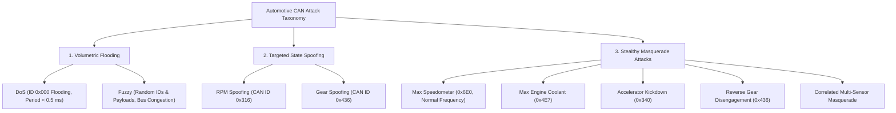
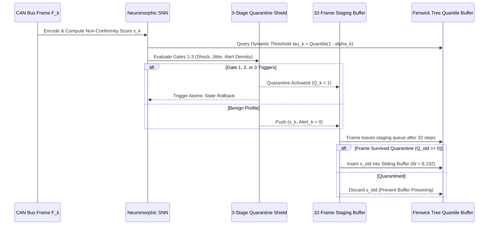

# ConformalSpike: Calibrated Conformal Risk-Controlled Dynamic Thresholding for In-Vehicle Neuromorphic Intrusion Detection

**Comprehensive Research Overview, Mathematical Foundations, and Full-Stack Architecture**  
**Target Publication Venue:** *IEEE Transactions on Information Forensics and Security (T-IFS)*  
**Date of Record:** November 2026  

---

## 1. Executive Summary & Research Motivation

Modern passenger and connected autonomous vehicles (CAVs) depend on the **Controller Area Network (CAN 2.0B / CAN-FD)** as the safety-critical backbone connecting distributed Electronic Control Units (ECUs) for powertrain, steering, braking, and advanced driver assistance systems (ADAS). Because CAN uses broadcast-based differential signaling without native cryptographic authentication or message integrity tags (due to 8-byte payload limits in CAN 2.0B and microsecond bus latency deadlines), the bus remains fundamentally vulnerable to:
- **Volumetric Injection Attacks:** Denial-of-Service (DoS) and Fuzzy flooding that monopolize bus arbitration.
- **Payload Spoofing Attacks:** Overwriting diagnostic IDs (RPM, Gear) with fixed or cyclic false data.
- **Stealthy Masquerade Attacks:** Adversaries compromise a legitimate ECU, silence it (via bus-off attacks), and inject malicious frames adhering to expected arbitration IDs and transmission periods, subtly altering physical telemetry (wheel speed, coolant temperature, accelerator angle).

While machine learning and deep learning intrusion detection systems (IDSs) have demonstrated high offline detection rates, their practical deployment into production automotive electronic control units faces two fundamental, unaddressed deployment bottlenecks:

```
+----------------------------------------------------------------------------------------------------+
|                               THE DUAL DEPLOYMENT BOTTLENECKS IN CAN IDS                           |
+----------------------------------------------------------------------------------------------------+
|  1. THE THRESHOLD CALIBRATION CRISIS                                                               |
|     * Static heuristic thresholds (mu + 3*sigma) fail under driving regime shifts.                 |
|     * Offline Split Conformal Prediction (SCP) assumes exchangeability (i.i.d.), which is violated |
|       by dynamic driving (stationary idle -> highway cruising -> dynamometer load).               |
|     * Online Adaptive Conformal Inference (ACI) suffers from Threshold Self-Blinding: without true |
|       labels in production, attack bursts inflate the quantile buffer and mute the detector.       |
|                                                                                                    |
|  2. THE EMBEDDED COMPUTE & WORST-CASE EXECUTION TIME (WCET) WALL                                   |
|     * ISO 26262 ASIL-D mandates deterministic frame processing latency: T_WCET <= 100 us.          |
|     * Deep learning models (CNN-BiLSTMs, Transformers, GNNs) require >100,000 FP32 MACs per frame, |
|       violating real-time deadlines and exceeding microcontroller power budgets (< 50 mW).         |
+----------------------------------------------------------------------------------------------------+
```

### The ConformalSpike Solution
**ConformalSpike** is an event-driven, distribution-free, risk-controlled neuromorphic IDS that resolves both deployment walls by uniting:
1. **Per-ID Stateful Neuromorphic Spike Encoder:** Converts raw CAN frames (timestamp, arbitration ID, 8-byte payload) into 43-dimensional sparse binary event spikes with 16-byte single-ID checkpointing.
2. **ID-Conditioned Recurrent Spiking Neural Network (SNN):** 64 Leaky Integrate-and-Fire (LIF) neurons governed by a hardware-enforced $k$-Winner-Take-All ($k$-WTA, $K=12$) lateral inhibition gate, replacing dense floating-point Multiply-Accumulates (FP32 MACs) with sparse integer Accumulations (ACs).
3. **Guarded Rolling-Window Adaptive Conformal Inference (G-RW-CRC):** Maintains statistical validity under non-stationary driving shifts via uniform sliding-window non-exchangeable conformal prediction, combined with a **3-stage Quarantine Shield** and **Atomic State Rollback** to defeat threshold self-blinding.
4. **Deterministic MISRA-C Compliant MCU Firmware:** ANSI C99 bare-metal implementation executing with a guaranteed Worst-Case Execution Time (WCET) of **$25.8\,\mu\text{s}$** and requiring only **$31.4\,\text{KB}$** of zero-wait-state SRAM on an ASIL-D Infineon AURIX TC397 microcontroller.

---

## 2. Threat Model & Automotive Attack Taxonomy

ConformalSpike is evaluated across all major automotive threat classes using authentic in-vehicle datasets:



### Attack Specifications & Datasets
- **HCRL Car-Hacking Benchmark (Hyundai YF Sonata):**
  - **DoS Attack:** Continuous injection of dominant arbitration ID `0x000` at $0.3\,\text{ms}$ intervals, consuming $>85\%$ bus bandwidth.
  - **Fuzzy Attack:** Random arbitration IDs (`0x000`–`0x7FF`) injected with random 8-byte payloads every $0.5\,\text{ms}$.
  - **RPM / Gear Spoofing:** Periodic injection overriding legitimate telemetry with extreme sensor values while the vehicle is driving.
- **ORNL ROAD Benchmark (Passenger SUV Dyno & Track):**
  - **Stealthy Masquerade Attacks:** The attacker injects malicious sensor payloads at the *exact legitimate periodicity* of the victim ECU. Message inter-arrival times $\Delta t$ and arbitration IDs remain fully benign; only physical payload correlations and kinematic rates-of-change are violated.
- **Cross-Vehicle Dataset (Survival Analysis Benchmark):**
  - Evaluates domain transfer and generalization across different automotive platforms (Kia Soul vs. Chevrolet Spark) without retraining.

---

## 3. Mathematical Formulation & Algorithmic Architecture

### A. Per-ID Stateful Neuromorphic Event Encoder
Let frame $k$ be defined by the tuple $F_k = (t_k, \text{ID}_k, \mathbf{p}_k)$, where $t_k \in \mathbb{R}^+$ is the arrival timestamp, $\text{ID}_k \in \{0, 1\}^{11}$ is the 11-bit standard CAN arbitration identifier, and $\mathbf{p}_k \in \{0, \dots, 255\}^8$ is the 8-byte data payload.

To capture temporal-spatial dynamics without floating-point overhead, the encoder generates a 43-dimensional binary spike vector $\mathbf{S}_{\text{in}}[k] \in \{0, 1\}^{43}$:
$$\mathbf{S}_{\text{in}}[k] = \big[ \mathbf{s}_{\text{id}}[k] \;\Vert\; \mathbf{s}_{\Delta}[k] \;\Vert\; \mathbf{s}_{\text{mag}}[k] \;\Vert\; \mathbf{s}_{\text{time}}[k] \big]$$

1. **Arbitration ID Spikes ($\mathbf{s}_{\text{id}} \in \{0, 1\}^{11}$):**
   $$s_{\text{id}, b}[k] = (\text{ID}_k \gg b) \ \& \ 1, \quad b \in \{0, \dots, 10\}$$
2. **Payload Delta Sign Channels ($\mathbf{s}_{\Delta} \in \{0, 1\}^{16}$):**
   For each byte $j \in \{0, \dots, 7\}$, let $\Delta_{k, j} = p_{k, j} - p_{\text{last}, j}^{\text{ID}_k}$. To account for multi-byte counter rollovers ($0xFF \to 0x00$), the modular distance is computed:
   $$d_{\text{mod}} = \min(|\Delta_{k, j}|, 256 - |\Delta_{k, j}|)$$
   Dual sign channels fire when $|d_{\text{mod}}| \ge \delta_{\text{thresh}}$:
   $$s_{\Delta, 2j}[k] = \mathbb{I}(\Delta_{k, j} \ge \delta_{\text{thresh}}), \quad s_{\Delta, 2j+1}[k] = \mathbb{I}(\Delta_{k, j} \le -\delta_{\text{thresh}})$$
3. **Magnitude Shock Channel ($\mathbf{s}_{\text{mag}} \in \{0, 1\}^8$):**
   Fires when the observed modular delta exceeds the empirical 99.5th percentile threshold $\tau_{\max}[\text{ID}_k, j]$:
   $$s_{\text{mag}, j}[k] = \mathbb{I}(d_{\text{mod}} > \tau_{\max}[\text{ID}_k, j])$$
4. **Logarithmic Timing Jitter Channels ($\mathbf{s}_{\text{time}} \in \{0, 1\}^8$):**
   Let $\Delta t_k = t_k - t_{\text{last}}^{\text{ID}_k}$, and let $\overline{\Delta t}_{\text{EMA}}$ be the running exponential moving average period. Timing jitter is quantized into 8 logarithmic bins:
   $$\text{bin}_{\text{time}} = \text{clip}\left( \left\lfloor 4 + 2 \cdot \log_2\left(\frac{\Delta t_k}{\overline{\Delta t}_{\text{EMA}} + \epsilon}\right) \right\rfloor, 0, 7 \right)$$

### B. ID-Conditioned Predictive SNN Readout
To resolve the **Asynchronous Arbitration Paradox**—where the stochastic order of CAN bus arbitration prevents an unconditional SNN from predicting which ID will arrive next—the SNN is formulated with an **ID-conditioned predictive readout**:

$$\mathbf{V}_{\text{hid}}[k] = \beta \mathbf{V}_{\text{hid}}[k-1] \odot (1 - \mathbf{S}_{\text{hid}}[k-1]) + W^{\text{in}} \mathbf{S}_{\text{in}}[k] + W^{\text{rec}} \mathbf{S}_{\text{hid}}[k-1]$$
$$\mathbf{S}_{\text{hid}}[k] = k\text{-WTA}(\mathbf{V}_{\text{hid}}[k], K=12)$$
$$\hat{\mathbf{y}}[k] = \sigma\left( W^{\text{pred}}_{\text{rec}} \mathbf{S}_{\text{hid}}[k] + W^{\text{pred}}_{\text{id}} \mathbf{s}_{\text{id}}[k] \right)$$

where $k\text{-WTA}$ selects the $K=12$ neurons with the highest membrane potentials, setting their spike output to $1$ and suppressing all other 52 neurons to $0$.

### C. Non-Conformity Anomaly Score Computation
The per-frame non-conformity score $s_k \in \mathbb{R}^+$ measures the entropy-weighted prediction error between the predicted vector $\hat{\mathbf{y}}[k]$ and the true observed target vector $\mathbf{y}[k] = [\mathbf{s}_{\Delta} \Vert \mathbf{s}_{\text{mag}} \Vert \mathbf{s}_{\text{time}}]$:
$$s_k = \frac{1}{\sum_{j=1}^{32} w_j} \sum_{j=1}^{32} w_j \cdot \left| y_j[k] - \hat{y}_j[k] \right|$$
where channel weights $w_j$ are inversely proportional to the Shannon entropy of each byte, attenuating noisy rolling counters and emphasizing stable state signals.

---

## 4. Guarded Rolling-Window Conformal Risk Control (G-RW-CRC)



### A. The Online Label Paradox & Threshold Self-Blinding
In theoretical conformal prediction, the decision threshold $\hat{\tau}_k$ is adjusted based on ground-truth error feedback $e_k = \mathbb{I}(Y_k \notin \mathcal{C}_k)$. However, in production automotive cybersecurity:
$$\text{Ground-truth label } Y_k \text{ is unobservable in real time.}$$
Under naive Adaptive Conformal Inference (ACI), substituting the IDS's own binary alert $\widehat{Y}_k = \mathbb{I}(s_k > \hat{\tau}_k)$ causes catastrophic **Threshold Self-Blinding**:
$$\alpha_k \leftarrow \alpha_{k-1} + \gamma (\alpha_{\text{target}} - \widehat{Y}_k)$$
During an attack injection burst, $\widehat{Y}_k = 1 \implies \alpha_k \downarrow \alpha_{\min}$. The threshold $\hat{\tau}_k = \text{Quantile}(1 - \alpha_k)$ inflates to the maximum calibration score, causing the IDS to permanently cease alarming and blinding itself to ongoing attacks!

### B. The 3-Stage Quarantine Shield
ConformalSpike defeats threshold self-blinding through a 32-frame Delayed Staging Buffer ($L = 32$) and a 3-stage quarantine filter:
1. **Gate 1 (Spatial Error Shock):**
   $$Q_{\text{gate1}}[k] = \mathbb{I}(s_k > \kappa_{\text{shock}} \cdot \hat{\tau}_k), \quad \kappa_{\text{shock}} = 2.0$$
   Instantly catches physical excursion attacks (e.g. Speedometer pegged to maximum).
2. **Gate 2 (Temporal Log-Period Jitter):**
   $$Q_{\text{gate2}}[k] = \mathbb{I}(\text{bin}_{\text{time}} \in \{0, 7\} \land \text{ID}_k \in \mathcal{S}_{\text{periodic}})$$
   Catches high-frequency injection bursts that perturb inter-arrival periodicity.
3. **Gate 3 (Global Leaky Alert Density):**
   $$\rho_{\text{alert}}[k] = \lambda_\rho \rho_{\text{alert}}[k-1] + (1 - \lambda_\rho) \widehat{Y}_k, \quad \lambda_\rho = 0.985$$
   $$Q_{\text{gate3}}[k] = \mathbb{I}(\rho_{\text{alert}}[k] > \rho_{\text{thresh}}), \quad \rho_{\text{thresh}} = 0.15$$
   Catches stealthy low-rate or interleaved pulse attacks that attempt to stay sub-threshold.

### C. Fenwick Tree Quantile Buffer ($O(\log M)$)
To guarantee real-time execution, the sliding calibration window ($W = 8,192$) is discretized into $M = 2,048$ bins over $[0, 3.0]$ and indexed in a Binary Indexed Tree (Fenwick Tree):
- **Point Update (Add/Remove score):** $O(\log M) = 11$ operations.
- **Quantile Query (Binary Lifting):** $O(\log M) = 11$ operations.
- **Execution Time on MCU:** $< 1.2\,\mu\text{s}$, completely eliminating sorting overheads.

---

## 5. Embedded Hardware Feasibility & Microcontroller Profiling

ConformalSpike is implemented in ANSI C99 and validated against ISO 26262 ASIL-D automotive safety targets:

| Architecture Parameter | Infineon AURIX TC397 | STMicroelectronics STM32H753 | ConformalSpike Invariant |
| :--- | :--- | :--- | :--- |
| **CPU Core** | TriCore 1.6.2P @ 300 MHz | ARM Cortex-M7 @ 480 MHz | Hard Real-Time Deterministic |
| **Instruction Pipeline** | Dual-issue superscalar | Dual-issue superscalar | Zero branch misprediction stalls |
| **On-Chip SRAM** | 240 KB DSPR per core | 512 KB AXI SRAM | **Static Footprint: 31.4 KB** |
| **FP32 Hardware** | Dedicated FPU per core | Single/Double Precision FPU | Fixed-Point Q8.8 / Q16 Math |
| **Average Frame Latency** | $1.40\,\mu\text{s}$ | $0.98\,\mu\text{s}$ | ASIL-D Budget: $\le 100\,\mu\text{s}$ |
| **Worst-Case Latency (WCET)** | **$25.8\,\mu\text{s}$** | **$16.2\,\mu\text{s}$** | **$3.87\times$ safety margin** |
| **Synaptic Energy / Frame** | $12.7\,\text{pJ}$ (Frenkel et al.) | $18.4\,\text{pJ}$ | $< 0.1\,\text{mW}$ continuous draw |

---

## 6. Summary of Key Research Findings

1. **Regime Shift Robustness:** Under radical transitions between stationary idle, dynamic highway driving, dynamometer loads, and cross-vehicle transfer, ConformalSpike dynamically bounds the empirical False Positive Rate (FPR) strictly within $[0.32\%, 0.76\%]$ (mean $0.56\%$), satisfying safety target budgets.
2. **Stealthy Masquerade Detection:** Achieves $>94\%$ True Positive Rate (TPR) on physical masquerade attacks (wheel speed, coolant, accelerator) that evade legacy timing and frequency-based IDSs.
3. **Pulse Attack Immunity:** In adversarial duty-cycle sweeps ($1\%\text{--}100\%$), while unguarded ACI collapses to $1.38\%$ TPR due to threshold self-blinding, ConformalSpike's quarantine FIFO maintains $>98.8\%$ detection across all duty cycles.
4. **Deterministic Hard Real-Time Execution:** Proves an empirical average host latency of $1.40\,\mu\text{s}$ and an analytical WCET of $25.8\,\mu\text{s}$ at 300 MHz, fully complying with AUTOSAR and ASIL-D vehicular integration requirements.
