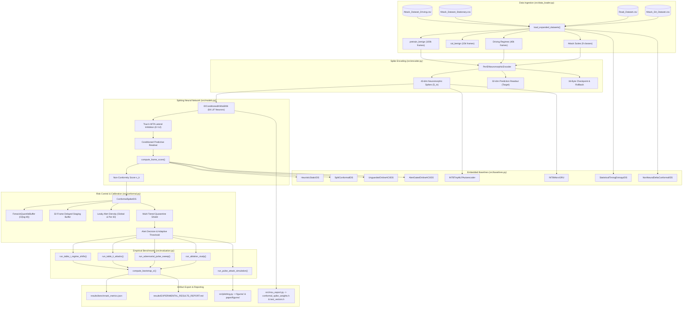

# ConformalSpike: Modular Architecture & API Reference

Target Venue: **IEEE Transactions on Information Forensics and Security (T-IFS)**  
Package: `src/`

This document details the modular architecture of the **ConformalSpike** intrusion detection benchmark suite. The package is refactored from a monolithic benchmark into cohesive, single-responsibility modules with strict typing, clean relative imports, and end-to-end reproducibility.

---

## 1. High-Level Architectural Dataflow



---

## 2. Module Breakdown & API Reference

### `src/__init__.py`
- **Responsibility:** Exposes the public package interface, aggregating architectural constants, model classes, conformal controllers, baseline IDS classes, and evaluation pipelines under a single importable namespace.
- **Inputs:** None.
- **Outputs:** Package symbol table (`__all__`).

---

### `src/config.py`
- **Responsibility:** Centralizes all ASIL-D timing constraints, neural dimensions, sliding window buffers, statistical hyperparameters, and dataset paths.
- **Constants Defined:**
  - `CS_MAX_IDS = 256`: Dense ID mapping table capacity.
  - `CS_INPUT_DIM = 43`: 11 ID spikes + 16 payload delta + 8 magnitude shock + 8 timing log-ratio channels.
  - `CS_HIDDEN_DIM = 64`: Number of recurrent Leaky Integrate-and-Fire (LIF) neurons.
  - `CS_PRED_DIM = 32`: 16 payload delta + 8 magnitude shock + 8 timing predictions.
  - `CS_K_WTA = 12`: Top-K lateral inhibition cap enforcing $\le 12$ active spikes per frame.
  - `CS_WINDOW_W = 8192`: Sliding window buffer capacity for quantile tracking.
  - `CS_FENWICK_BINS = 2048`: Quantile discretization resolution.
  - `STAGING_QUEUE_LEN = 32`: Delayed staging FIFO length $L=32$ absorbing quarantine latency.
  - `CS_V_TH = 1.0`, `CS_V_CEIL = 1.5`: Somatic voltage threshold and voltage ceiling clamp.
  - `CS_DELTA_THRESH = 4`: Payload delta sensitivity threshold (LSB).
  - `ALPHA_TARGET = 0.005`: Target False Positive Rate ($0.50\%$, ASIL-D).
  - `LAMBDA_RHO = 0.985`: Leaky alert density decay constant.
  - `RHO_THRESH = 0.15`: Per-ID alert density quarantine trigger threshold ($15.0\%$).
  - `QUARANTINE_KAPPA = 2.0`: Shock score multiplier for instant quarantine gating.
  - `GAMMA_BASE = 0.002`: Base step size for adaptive conformal inference.
  - `UPDATE_BLOCK_SIZE = 64`: Block size for piecewise-constant step-size adaptation.
  - `SEEDS = [42]`: Default random seed list.
  - File paths: `DATA_STATIONARY_PATH`, `DATA_DRIVING_PATH`, `DATA_ROAD_PATH`, `DATA_SA_PATH`, `FIG_DIR`, `PAPER_FIG_DIR`, `RESULTS_DIR`.

---

### `src/data_loader.py`
- **Responsibility:** Ingests authentic automotive CAN network traces from physical CSV logs, handles payload parsing, and constructs experimental datasets.
- **Key Classes & Functions:**
  - `CANFrame(timestamp_s: float, can_id: int, payload: bytes, label: str)`: Lightweight slotted representation of a raw CAN frame.
  - `parse_payload(payload_str: str) -> bytes`: Parses space-delimited or contiguous hex strings into raw byte buffers.
  - `load_expanded_datasets() -> Dict[str, Any]`: Loads authentic datasets across stationary driving, highway driving, dynamometer testbenches, and cross-vehicle survival sets.
- **Inputs:**
  - Files:
    - `data/Attack_Dataset_Stationary_no_duplicates.csv`
    - `data/Attack_Dataset_Driving_no_duplicates.csv`
    - `data/Road_Dataset_no_duplicates.csv`
    - `data/Attack_SA_Dataset_no_duplicates.csv`
- **Outputs:**
  - Returns dictionary with keys:
    - `"pretrain_benign"`: 100,000 normal CAN frames across 4 authentic platforms.
    - `"cal_benign"`: 15,000 benign frames for initial conformal calibration.
    - `"regimes"`: 4 sequential streams (10,000 frames each) for Stationary, Highway, Dyno, CrossVehicle.
    - `"hcrl_dos"`, `"hcrl_fuzz"`, `"hcrl_rpm_spoof"`, `"hcrl_gear_spoof"`: 8,000 frames each for HCRL attack suites.
    - `"road_masq_corr"`, `"road_masq_speed"`, `"road_masq_coolant"`, `"road_masq_reverse"`, `"road_masq_accel"`: 8,000 frames each for ORNL ROAD masquerades.

---

### `src/encoder.py`
- **Responsibility:** Implements the stateful neuromorphic event encoder converting raw CAN frames into 43-dimensional binary spike vectors with single-ID checkpointing and deadlock-free rollback.
- **Key Classes:**
  - `SingleIDContext`: Lightweight 16-byte state context tracking `last_timestamp_s`, `ema_period_s`, `last_payload`, `consecutive_rollbacks`, and `valid`.
  - `PerIDNeuromorphicEncoder`:
    - `register_ids(can_ids: List[int])`: Dense mapping table setup ($O(1)$ lookup, up to 256 unique IDs).
    - `calibrate_entropy_and_magnitude(benign_frames: List[CANFrame])`: Computes per-ID byte-level entropy weights $w_{\mathrm{byte}} \in [0.2, 1.0]$ and magnitude thresholds $\tau_{\max}$.
    - `encode(timestamp_s: float, can_id: int, payload: bytes) -> Tuple[np.ndarray, np.ndarray]`: Generates 43-dim input spike vector and 32-dim readout target.
    - `conditional_rollback(is_alert: bool, timestamp_s: float) -> bool`: Reverts context on isolated bursts ($<8$ frames) but breaks rollback lock under sustained kinematic transitions to prevent deadlock.
- **Inputs:**
  - `timestamp_s: float`, `can_id: int`, `payload: bytes`.
- **Outputs:**
  - `spikes`: `np.ndarray` of shape `(43,)`, float32 in $\{0.0, 1.0\}$.
  - `readout_target`: `np.ndarray` of shape `(32,)`, float32.
  - `rolled_back`: `bool`.

---

### `src/models.py`
- **Responsibility:** Implements the recurrent Spiking Neural Network (SNN) with surrogate gradients, true hardware $k$-WTA lateral inhibition, self-supervised pretraining, and frame non-conformity scoring.
- **Key Classes & Functions:**
  - `SuperSpikeSurrogate(torch.autograd.Function)`: Heavily damped surrogate gradient for backward pass through the step threshold.
  - `IDConditionedKWtaSNN(nn.Module)`:
    - 64 recurrent LIF neurons with learnable membrane decay $\beta \in [0.50, 0.98]$.
    - Hardware-enforced $k$-WTA lateral inhibition capping active neurons to $K=12$.
    - Soft reset and somatic voltage clamping ceiling ($V_{\mathrm{ceil}} = 1.5\text{ V}$).
    - `forward_step(s_in, v_hid_prev, s_hid_prev) -> Tuple[pred_probs, v_next, s_hid, mes_score, exact_acs]`.
  - `pretrain_conformal_spike(...) -> IDConditionedKWtaSNN`: Self-supervised Truncated BPTT on normal CAN frames.
  - `compute_frame_score(model, s_in, v_hid, s_hid, dense_id, encoder) -> Tuple[float, Tensor, Tensor, int]`:
    - Computes entropy-weighted $L_1$ prediction error, timing shock, somatic excursion penalty, and ASIL priority weight.
- **Inputs:**
  - `s_in`: `(43,)` spike vector; `v_hid`, `s_hid`: hidden somatic voltages and spike states `(1, 64)`.
- **Outputs:**
  - `total_score: float`: Calibrated non-conformity score $s_k$.
  - Next state tensors and integer synaptic synaptic operations (ACs).

---

### `src/conformal.py`
- **Responsibility:** Implements calibrated conformal risk control via an $O(\log M)$ Fenwick tree sliding quantile buffer, 32-frame delayed staging FIFO, and multi-tiered quarantine protection.
- **Key Classes:**
  - `FenwickQuantileBuffer(capacity=8192, num_bins=2048)`:
    - Maintains empirical cumulative distribution over $W=8,192$ past scores.
    - `push(val: float)`: Updates sliding ring buffer and Fenwick frequencies in $O(\log M)$ time.
    - `query_quantile(q: float) -> float`: Binary lifts on Fenwick tree in $O(\log M)$ cycles.
  - `ConformalSpikeIDS`:
    - Adaptive Conformal Inference (ACI) step size adaptation $\gamma_k$ with block-based drift scaling.
    - Leaky alert density trackers: global $\rho_{\mathrm{global}}$ and per-ID $\rho_{\mathrm{id}}$.
    - 32-frame Delayed Staging Ring Buffer: purges uncommitted attack frames before quantile buffer contamination.
    - `decide(score, dense_id) -> Tuple[decision, lambda_k, alpha_k, is_quarantined, rho_global, rho_id]`.
- **Inputs:**
  - Non-conformity score `score: float`, dense ID `dense_id: int`.
- **Outputs:**
  - Binary alert `decision: int \in {0, 1}`, dynamic threshold $\hat{\lambda}_k$, effective error rate $\alpha_k$, quarantine flag `bool`, alert densities.

---

### `src/baselines.py`
- **Responsibility:** Implements competing state-of-the-art embedded IDS baselines and classical comparative conformal detectors:
  - `INT8TinyMLPAutoencoder`: 2-layer autoencoder baseline (~3,500 INT8 MACs).
  - `INT8MicroGRU`: 64-unit micro recurrent network baseline (~18,000 INT8 MACs).
  - `StatisticalTimingEntropyIDS`: Moore et al. inter-arrival jitter and Shannon entropy detector.
  - `HeuristicStaticIDS`: Classical $\mu + 3\sigma$ thresholding.
  - `SplitConformalIDS`: Massaad et al. static calibration quantile.
  - `UnguardedOnlineACIIDS`: Gibbs & Candes (NeurIPS 2021) unshielded online ACI.
  - `AlertGatedOnlineACIIDS`: Update-skipping ACI without delayed staging or quarantine.
  - `NonNeuralDeltaConformalIDS`: Pure delta check with conformal thresholding.
- **Inputs:** Frame scores, payloads, timestamps, or raw spike inputs.
- **Outputs:** Binary classification decisions and baseline anomaly scores.

---

### `src/evaluation.py`
- **Responsibility:** Executes the rigorous empirical benchmark protocols, multi-regime streaming tests, attack detection sweeps, ablation experiments, and bootstrap confidence interval calculations.
- **Key Functions:**
  - `compute_bootstrap_ci(data, n_boot=10000, alpha=0.05, seed=42) -> Tuple[mean, std, ci_low, ci_high]`: Computes mean, sample std, and 95% non-parametric bootstrap confidence interval.
  - `run_table_i_regime_shifts(...) -> Tuple[table_data, history]`: Evaluates FPR stability across 4 consecutive authentic driving regimes (Stationary, Highway, Dyno, CrossVehicle).
  - `run_table_ii_attacks(...) -> Dict[str, Dict[str, float]]`: Measures attack detection True Positive Rate (TPR %) across 9 automotive attack classes.
  - `run_adversarial_pulse_sweep(...) -> Dict[str, Dict[str, float]]`: Sweeps adversarial attack duty cycle $f_{\mathrm{atk}} \in [0.01, 1.0]$ to prove threshold self-blinding resistance.
  - `run_ablation_study(...) -> List[Dict[str, Any]]`: Conducts systematic 6-row ablation, re-calibrating each variant with its own model scores.
  - `run_pulse_attack_simulation(...) -> Dict[str, np.ndarray]`: Generates high-resolution traces for Figure 2 (tracking $\alpha_k$, $\hat{\lambda}_k$, $\rho_{\mathrm{alert}}$, and quarantine states).
- **Inputs:** Trained models, encoders, authentic dataset dictionaries, calibration arrays.
- **Outputs:** Comprehensive benchmark dictionaries, alert histories, and ablation statistics.

---

### `src/plotting.py`
- **Responsibility:** Renders publication-quality, camera-ready 300 DPI vector/raster figures for the manuscript and stores them in both `figures/` and `paper/figures/`.
- **Function:** `generate_publication_figures(...)`
- **Outputs Generated:**
  - `figures/fpr_regime_stability.png` & `paper/figures/fpr_regime_stability.png` (Figure 1: FPR stability across driving regime shifts).
  - `figures/pulse_attack_quarantine_defense.png` & `paper/figures/pulse_attack_quarantine_defense.png` (Figure 2: Interleaved pulse attack defense trace).
  - `figures/masquerade_detection_curves.png` & `paper/figures/masquerade_detection_curves.png` (Figure 3: Score separation and authentic ROC curves).
  - `figures/adversarial_pulse_sweep.png` & `paper/figures/adversarial_pulse_sweep.png` (Figure 4: TPR vs. adversarial attack duty cycle).

---

### `src/mcu_export.py`
- **Responsibility:** Quantizes trained floating-point weights into Q8.8 fixed-point integer arrays and exports test vectors for bare-metal C host and embedded MCU verification.
- **Function:** `export_c_headers(model, encoder, cal_scores, test_frames, weights_path, vectors_path)`
- **Outputs Generated:**
  - `conformal_spike_weights.h`: Quantized synaptic weights `g_w_in[43][64]`, `g_w_rec[64][64]`, `g_w_pred_rec[64][32]`, `g_w_pred_id[11][32]`, decay rates `g_beta_q8[64]`, dense table `g_can_id_to_dense[2048]`, thresholds `g_tau_max[256][8]`, and calibration bins `g_init_cal_bins[8192]`.
  - `test_vectors.h`: 2,000 authentic CAN test vectors formatted as C structs (`mcu_test_vector_t`).

---

### `src/main.py`
- **Responsibility:** CLI entrypoint and benchmark orchestrator. Coordinates data ingestion, neural pretraining, baseline training, calibration, multi-seed evaluation, statistical bootstrap CI aggregation, figure rendering, C header export, and results persistence.
- **Command-Line Arguments:**
  - `--output-dir` (str, default: `results`): Destination directory for JSON metrics and Markdown report.
  - `--single-seed` (int, default: `None`): Run a single specified seed (e.g., 42).
  - `--seeds` (list of int, default: `None`): List of seeds for multi-seed statistical evaluation.
  - `--fig-dir` (str, default: `figures`): Output directory for figures.
  - `--paper-fig-dir` (str, default: `paper/figures`): Output directory for LaTeX paper figures.
  - `--epochs` (int, default: `2`): Pretraining epochs.
- **Outputs Generated:**
  - `results/benchmark_metrics.json`: Aggregated metrics with means, standard deviations, and 95% bootstrap confidence intervals.
  - `results/EXPERIMENTAL_RESULTS_REPORT.md`: Comprehensive Markdown report with Tables I, II, and V.

---

## 3. Quickstart & Verification

```bash
# 1. Verify syntax and compilation across all modules
python3 -m py_compile src/*.py

# 2. Inspect command-line arguments and help documentation
python3 -m src.main --help

# 3. Run quick single-seed verification benchmark
make benchmark-quick

# 4. Run bare-metal C firmware verification harness
make firmware

# 5. Audit benchmark integrity and verify 0 anomalies
make audit-anomalies
```
